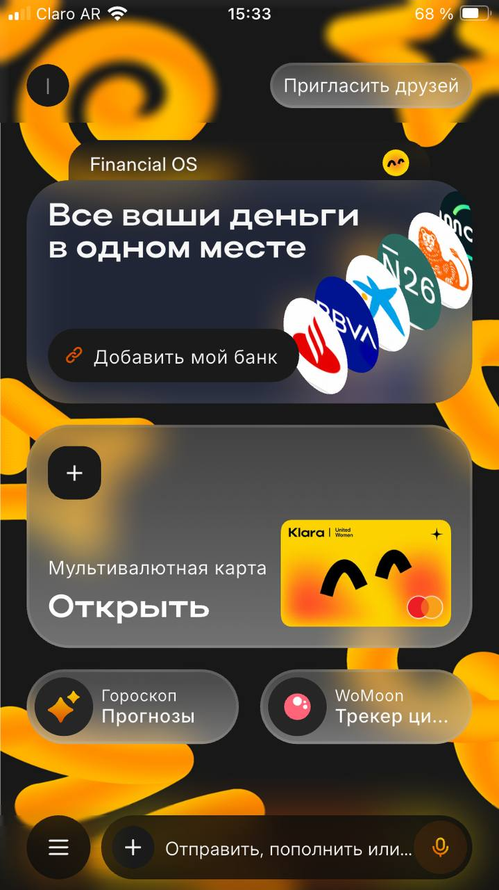
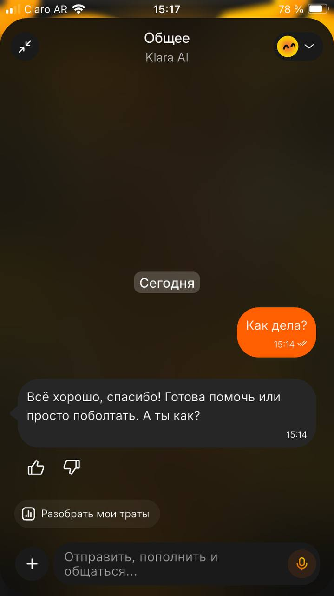
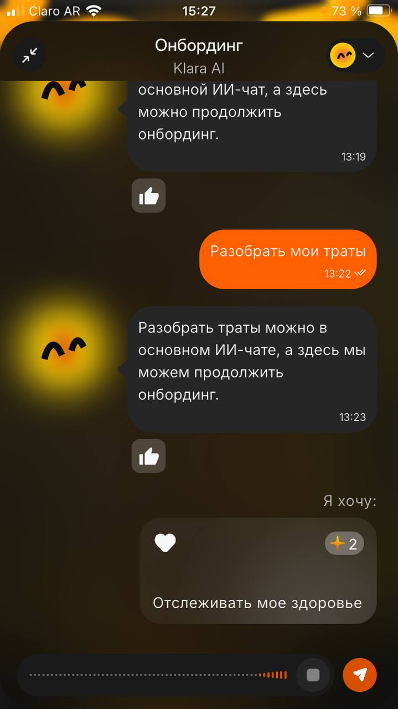
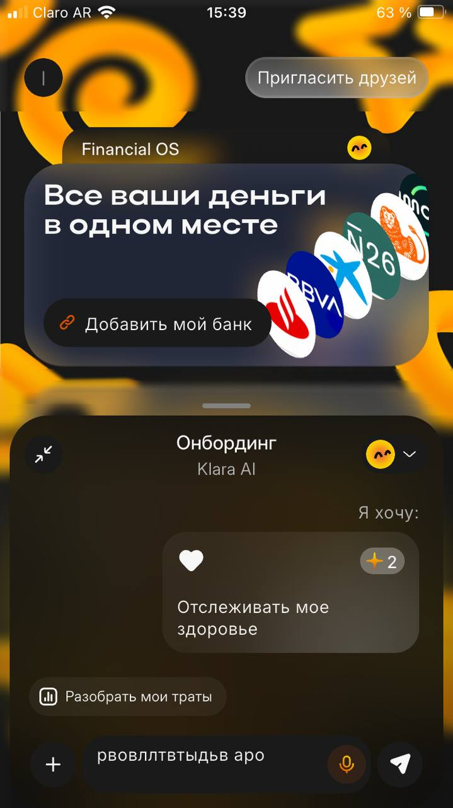
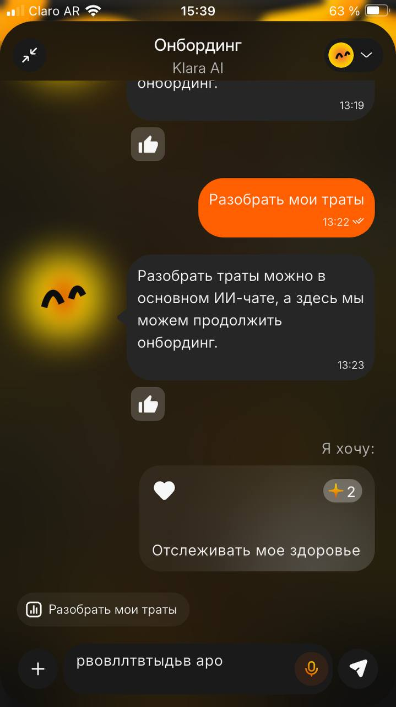

# Klara AI — дефекты

## #1 [Bug] Добро пожаловать: Иконка телефона толще иконок Apple и Google
Severity: trivial

**Экран:** Добро пожаловать
**Окружение:** iPhone SE · iOS: уточнить · версия приложения: уточнить · язык интерфейса: русский · тема: тёмная

**Шаги воспроизведения**
1. Открыть приложение без авторизации
2. Сравнить иконки кнопок входа

**Ожидаемый результат**
Иконки способов входа одинаковы по толщине линий и визуальному весу.

**Фактический результат**
Иконка у кнопки «Продолжить с телефоном» заметно жирнее и создаёт ложный акцент на этом способе входа.

**Предлагаемое решение**
Вероятная причина: иконки из разных наборов. Логотипы Apple и Google — брендовые SVG, телефон — шрифтовая иконка с другой толщиной.
Решение: все иконки кнопок входа берутся из одного набора через общий виджет кнопки авторизации. Размер и цвет приходят из IconTheme. Для вариативных шрифтовых иконок толщина задаётся один раз в IconThemeData.weight на уровне темы — в коде экрана её не трогают.

**Референсы**
- [Flutter API — IconTheme](https://api.flutter.dev/flutter/widgets/IconTheme-class.html)
- [Flutter API — IconThemeData.weight (толщина вариативных иконок)](https://api.flutter.dev/flutter/widgets/IconThemeData/weight.html)

**Связанные кейсы:** KLARA-1 (Экран «Добро пожаловать»: вёрстка на iPhone SE)

_Примечание: Нужен скриншот экрана приветствия._

## #2 [Bug] Добро пожаловать: Фоновый текст перекрывает заголовок на iPhone SE
Severity: minor

**Экран:** Добро пожаловать
**Окружение:** iPhone SE · iOS: уточнить · версия приложения: уточнить · язык интерфейса: русский · тема: тёмная

**Шаги воспроизведения**
1. Открыть приложение без авторизации на iPhone SE

**Ожидаемый результат**
Заголовок «Добро пожаловать» и фоновые тексты не пересекаются на экранах высотой 667 pt.

**Фактический результат**
Мелкий текст на фоне в верхней части экрана накладывается на крупный заголовок.

**Предлагаемое решение**
Вероятная причина: декоративный фон и заголовок позиционированы в одном Stack абсолютными координатами от верха экрана, без учёта доступной высоты.
Решение: развести слои. Декор — нижний слой Stack через Positioned.fill, вне SafeArea. Контент — в SafeArea, раскладка через Column и Spacer внутри LayoutBuilder, поэтому позиции зависят от высоты. Если высоты не хватает, второстепенный декоративный текст скрывается по правилу из токенов дизайн-системы — без проверок под конкретную модель айфона. Пример адаптивных размеров по устройству — масштабируемые токены в Wonderous.

**Референсы**
- [Flutter API — Positioned.fill](https://api.flutter.dev/flutter/widgets/Positioned/Positioned.fill.html)
- [Flutter API — LayoutBuilder](https://api.flutter.dev/flutter/widgets/LayoutBuilder-class.html)
- [Flutter API — SafeArea](https://api.flutter.dev/flutter/widgets/SafeArea-class.html)
- [Wonderous — lib/styles/styles.dart, класс _Insets (токены отступов $styles.insets)](https://github.com/gskinnerTeam/flutter-wonderous-app/blob/main/lib/styles/styles.dart#L222)

**Связанные кейсы:** KLARA-1 (Экран «Добро пожаловать»: вёрстка на iPhone SE), KLARA-61 (Малый экран iPhone SE: все экраны)

_Примечание: Нужен скриншот экрана приветствия._

## #3 [UX] Согласия: Разная механика согласия: при входе неявная, в WoMoon — обязательный чекбокс
Severity: minor

**Экран:** Согласия
**Окружение:** iPhone SE · iOS: уточнить · версия приложения: уточнить · язык интерфейса: русский · тема: тёмная

**Шаги воспроизведения**
1. На экране приветствия войти через любой способ
2. Открыть WoMoon и дойти до подтверждения 18+

**Ожидаемый результат**
Во всём приложении одна модель согласия: либо явный чекбокс везде, либо неявное согласие с поясняющим текстом везде.

**Фактический результат**
При входе согласие с условиями засчитывается нажатием «Продолжить с …» (состояние «уже отмечено»). В WoMoon кнопка «Начать» неактивна, пока пользователь сам не отметит «Мне исполнилось 18 лет». Пользователь ожидает той же логики, что при входе, и не понимает, почему кнопка неактивна.

**Предлагаемое решение**
Решение продуктовое и юридическое: выбрать одну политику согласий и реализовать её одним компонентом.
Вариант А: явный чекбокс везде (регистрация, 18+, данные о здоровье). Один shared-виджет ConsentCheckbox с состоянием ошибки.
Вариант Б: неявное согласие текстом там, где закон это позволяет, и явное для особых категорий данных (здоровье — ст. 9 GDPR). Тогда рядом с чекбоксом WoMoon нужно пояснение, почему здесь требуется отдельное действие.

**Референсы**
- [GDPR ст. 9 — особые категории данных (здоровье)](https://gdpr-info.eu/art-9-gdpr/)

**Связанные кейсы:** KLARA-8 (Единообразие согласий по всему приложению), KLARA-43 (WoMoon: открытие и согласие)

## #4 [Bug] Вход через Apple: Первая попытка входа зависает без сообщения об ошибке
Severity: major

**Экран:** Вход через Apple
**Окружение:** iPhone SE · iOS: уточнить · версия приложения: уточнить · язык интерфейса: русский · тема: тёмная

**Шаги воспроизведения**
1. Чистая установка
2. Нажать «Продолжить с Apple»
3. Подтвердить Touch ID

**Ожидаемый результат**
Вход выполняется с первой попытки. При сбое показывается понятная ошибка и кнопка повтора.

**Фактический результат**
После подтверждения Touch ID вход не происходит, ошибки нет, пользователь остаётся на экране. Вход прошёл только при повторной попытке с долгим удержанием пальца на Touch ID.

**Предлагаемое решение**
Вероятная причина: исключение из Sign in with Apple (например, SignInWithAppleAuthorizationException) или ошибка обмена токена на бэкенде не обрабатывается, и UI остаётся в ожидании.
Решение: оформить вход как Command (паттерн из документации Flutter). Пока команда в состоянии running, кнопка показывает загрузку и заблокирована. Результат возвращается как Result: отмена пользователем — тихий возврат, ошибка — сообщение и кнопка «Повторить». Каждую ошибку логировать с кодом в Crashlytics или Sentry: так станет понятна причина нестабильного воспроизведения.

**Референсы**
- [pub.dev — sign_in_with_apple](https://pub.dev/packages/sign_in_with_apple)
- [Flutter docs — Command pattern (состояния running / error)](https://docs.flutter.dev/app-architecture/design-patterns/command)
- [Flutter docs — Result pattern](https://docs.flutter.dev/app-architecture/design-patterns/result)

**Связанные кейсы:** KLARA-2 (Вход через Apple: новый пользователь)

_Примечание: Воспроизводимость нестабильная. Нужен скринкаст._

## #5 [Bug] Вход через Apple: Нет тактильного отклика при успешном входе
Severity: trivial

**Экран:** Вход через Apple
**Окружение:** iPhone SE · iOS: уточнить · версия приложения: уточнить · язык интерфейса: русский · тема: тёмная

**Шаги воспроизведения**
1. Войти через Apple с подтверждением Touch ID

**Ожидаемый результат**
Успешный вход сопровождается haptic success, как другие действия в приложении.

**Фактический результат**
Вход выполнен без вибрации.

**Предлагаемое решение**
Решение: вызывать хаптику из одного сервиса приложения (обёртка над HapticFeedback), а не точечно на экранах. Успешное завершение команды входа вызывает событие success.
Проверить: подтверждение Touch ID на iOS само даёт системный отклик. Возможно, его гасит кастомный экран-оверлей.

**Референсы**
- [Flutter API — HapticFeedback](https://api.flutter.dev/flutter/services/HapticFeedback-class.html)

**Связанные кейсы:** KLARA-2 (Вход через Apple: новый пользователь)

## #6 [Bug] Юридические документы: Ссылки на условия и политику открывают WebView с cookie-баннером сайта
Severity: normal

**Экран:** Юридические документы
**Окружение:** iPhone SE · iOS: уточнить · версия приложения: уточнить · язык интерфейса: русский · тема: тёмная

**Шаги воспроизведения**
1. На экране приветствия нажать «Условия использования»

**Ожидаемый результат**
Пользователь видит текст условий внутри приложения. Любое согласие или отказ в этом окне относится к приложению.

**Фактический результат**
Открывается WebView сайта myklara.ai: виден заголовок Legal and Policy и cookie-баннер «Accept all / Reject all». Баннер касается сайта и не влияет на приложение, но пользователь воспринимает «Reject all» как отказ от условий приложения. После закрытия WebView непонятно, принял ли пользователь условия.

**Предлагаемое решение**
Вариант А (рекомендуемый): нативный экран документа. Текст хранится на сервере в Markdown — единый источник для сайта и приложения. Приложение рендерит его через flutter_markdown_plus и кэширует на устройстве для офлайн-доступа.
Вариант Б: если WebView остаётся — открывать встраиваемую версию страницы без cookie-баннера и навигации сайта, а в webview_flutter через NavigationDelegate разрешить только домен myklara.ai.

**Референсы**
- [pub.dev — flutter_markdown_plus (преемник flutter_markdown)](https://pub.dev/packages/flutter_markdown_plus)
- [pub.dev — webview_flutter (NavigationDelegate)](https://pub.dev/packages/webview_flutter)

**Связанные кейсы:** KLARA-7 (Открытие условий использования и политики конфиденциальности), KLARA-64 (Внешние страницы и WebView)

## #7 [Bug] Главный экран: Текст карточки виртуальной карты перекрывает «Добро пожаловать» на iPhone SE
Severity: minor · Вложения: screenshots/home-screen.jpg

**Экран:** Главный экран
**Окружение:** iPhone SE · iOS: уточнить · версия приложения: уточнить · язык интерфейса: русский · тема: тёмная

**Шаги воспроизведения**
1. Открыть главный экран на iPhone SE

**Ожидаемый результат**
Тексты карточек и приветствия не пересекаются на компактных экранах.

**Фактический результат**
Текст о виртуальной карте накладывается на текст «Добро пожаловать».

**Предлагаемое решение**
Вероятная причина: карточки фиксированной высоты, текст позиционирован абсолютно.
Решение: экран строится на CustomScrollView. Высоты карточек определяются контентом, адаптация — через LayoutBuilder и токены дизайн-системы. Второстепенный текст скрывается правилом компонента карточки при нехватке места.

**Референсы**
- [Flutter API — LayoutBuilder](https://api.flutter.dev/flutter/widgets/LayoutBuilder-class.html)
- [Flutter API — ThemeExtension (токены дизайн-системы)](https://api.flutter.dev/flutter/material/ThemeExtension-class.html)

**Связанные кейсы:** KLARA-14 (Главный экран: отображение на iPhone SE), KLARA-61 (Малый экран iPhone SE: все экраны)

**Скриншоты**

_Примечание: Нужен скриншот с перекрытием._

## #8 [Bug] Главный экран: Тап по полю ввода открывает чат без активной клавиатуры
Severity: minor · Вложения: screenshots/home-screen.jpg

**Экран:** Главный экран
**Окружение:** iPhone SE · iOS: уточнить · версия приложения: уточнить · язык интерфейса: русский · тема: тёмная

**Шаги воспроизведения**
1. На главном экране тапнуть по полю «Отправить, пополнить или…»

**Ожидаемый результат**
Чат открывается, поле ввода в фокусе, клавиатура открыта.

**Фактический результат**
Чат открывается без фокуса, для ввода нужен второй тап.

**Предлагаемое решение**
Решение: передавать в маршрут чата намерение сфокусировать поле. После завершения анимации маршрута вызывать focusNode.requestFocus(), чтобы клавиатура не конфликтовала с анимацией открытия. Если анимация короткая — достаточно TextField.autofocus.

**Референсы**
- [Flutter cookbook — Focus and text fields](https://docs.flutter.dev/cookbook/forms/focus)

**Связанные кейсы:** KLARA-17 (Поле ввода на главном экране открывает чат с клавиатурой)

**Скриншоты**

## #9 [Bug] AI-чат · лента: Время и статус сообщения всегда переносятся на отдельную строку
Severity: trivial · Вложения: screenshots/chat-general-bubbles.jpg

**Экран:** AI-чат · лента
**Окружение:** iPhone SE · iOS: уточнить · версия приложения: уточнить · язык интерфейса: русский · тема: тёмная

**Шаги воспроизведения**
1. Открыть чат «Общее»
2. Отправить «Как дела?»

**Ожидаемый результат**
Время и статус стоят справа на последней строке текста, если там хватает места.

**Фактический результат**
Блок «время + статус» занимает отдельную строку даже у коротких сообщений, каждое сообщение выше на строку. На iPhone SE на экран помещается меньше сообщений.

**Предлагаемое решение**
Вариант А: свой виджет текста сообщения. Последняя строка замеряется через TextPainter. Если справа хватает места под время и статус, блок рисуется в правом нижнем углу той же строки. Если не хватает — переносится на новую строку. Это приём Telegram.
Вариант Б: взять готовую реализацию flyer_chat_text_message с timeAndStatusPosition.inline.

**Референсы**
- [Flutter API — TextPainter (замер последней строки текста)](https://api.flutter.dev/flutter/painting/TextPainter-class.html)
- [Flyer Chat docs — timeAndStatusPosition.inline](https://flyer-astro.pages.dev/docs/flutter/guides/status-indicators)
- [pub.dev — flyer_chat_text_message](https://pub.dev/packages/flyer_chat_text_message)

**Связанные кейсы:** KLARA-20 (Вёрстка пузырей сообщений)

**Скриншоты**

## #10 [Bug] AI-чат · лента: Текст в пузыре заходит в зону скругления угла
Severity: trivial · Вложения: screenshots/chat-general-bubbles.jpg

**Экран:** AI-чат · лента
**Окружение:** iPhone SE · iOS: уточнить · версия приложения: уточнить · язык интерфейса: русский · тема: тёмная

**Шаги воспроизведения**
1. Открыть чат «Общее» с ответом Klara

**Ожидаемый результат**
Внутренний отступ пузыря соразмерен радиусу скругления, текст не заходит в зону угла.

**Фактический результат**
При большом радиусе отступ мал: заглавная «В» в «Всё хорошо, спасибо!» визуально режет левый верхний угол.

**Предлагаемое решение**
Решение: радиус скругления и внутренний отступ пузыря — один токен темы (ChatBubbleTheme через ThemeExtension). Отступ вычисляется из радиуса внутри токена, поэтому поменять одно без другого нельзя.

**Референсы**
- [Flutter API — ThemeExtension (токены дизайн-системы)](https://api.flutter.dev/flutter/material/ThemeExtension-class.html)

**Связанные кейсы:** KLARA-20 (Вёрстка пузырей сообщений)

**Скриншоты**

## #11 [Bug] AI-чат · реакции: Лайк закрашивается с задержкой около 0,5 с
Severity: minor · Вложения: screenshots/chat-general-bubbles.jpg

**Экран:** AI-чат · реакции
**Окружение:** iPhone SE · iOS: уточнить · версия приложения: уточнить · язык интерфейса: русский · тема: тёмная

**Шаги воспроизведения**
1. Нажать 👍 под ответом Klara

**Ожидаемый результат**
Иконка закрашивается в момент нажатия вместе с тактильным откликом.

**Фактический результат**
Тактильный отклик мгновенный, иконка закрашивается примерно через полсекунды — похоже, после ответа сервера.

**Предлагаемое решение**
Вероятная причина: иконка обновляется после ответа сервера.
Решение: паттерн Optimistic state из документации Flutter. ViewModel меняет состояние сразу, запрос идёт в фоне, при ошибке состояние откатывается и показывается тост.

**Референсы**
- [Flutter docs — Optimistic state](https://docs.flutter.dev/app-architecture/design-patterns/optimistic-state)
- [Flutter docs — Command pattern (состояния running / error)](https://docs.flutter.dev/app-architecture/design-patterns/command)

**Связанные кейсы:** KLARA-23 (Лайк и дизлайк ответа)

**Скриншоты**

## #12 [UX] AI-чат · реакции: Реакции вынесены отдельным блоком под сообщением
Severity: trivial · Вложения: screenshots/chat-general-bubbles.jpg

**Экран:** AI-чат · реакции
**Окружение:** iPhone SE · iOS: уточнить · версия приложения: уточнить · язык интерфейса: русский · тема: тёмная

**Шаги воспроизведения**
1. Открыть чат с ответом Klara

**Ожидаемый результат**
Реакции не добавляют высоту и не отвлекают от текста.

**Фактический результат**
Блок 👍/👎 стоит отдельным объектом со своими отступами, увеличивает высоту каждого ответа и привлекает внимание при первом знакомстве.

**Предлагаемое решение**
Решение: реакция становится частью виджета пузыря — бейдж в углу. Выбор реакции — по долгому тапу через контекстное меню, как в Telegram и iMessage.

**Референсы**
- [Flutter API — CupertinoContextMenu](https://api.flutter.dev/flutter/cupertino/CupertinoContextMenu-class.html)

**Связанные кейсы:** KLARA-23 (Лайк и дизлайк ответа)

**Скриншоты**

## #13 [UX] AI-чат · подсказки: Подсказка «Разобрать мои траты» постоянно закреплена над полем ввода
Severity: minor · Вложения: screenshots/chat-general-bubbles.jpg, screenshots/chat-onboarding-voice-recording.jpg

**Экран:** AI-чат · подсказки
**Окружение:** iPhone SE · iOS: уточнить · версия приложения: уточнить · язык интерфейса: русский · тема: тёмная

**Шаги воспроизведения**
1. Открыть чат
2. Прокрутить историю

**Ожидаемый результат**
Подсказки прокручиваются вместе с историей и не занимают место постоянно. Отступы над и под подсказкой одинаковые.

**Фактический результат**
Чип закреплён и постоянно занимает высоту. Отступ над чипом больше, чем отступ под полем ввода.

**Предлагаемое решение**
Вариант А: подсказки — последний элемент списка сообщений. Они прокручиваются вместе с историей и уходят из поля зрения.
Вариант Б: плавающий SliverPersistentHeader, который прячется при прокрутке и появляется при обратном скролле.
Отступы над подсказкой и под полем ввода берутся из одного токена.

**Референсы**
- [Flutter API — SliverPersistentHeader](https://api.flutter.dev/flutter/widgets/SliverPersistentHeader-class.html)
- [Flutter API — ThemeExtension (токены дизайн-системы)](https://api.flutter.dev/flutter/material/ThemeExtension-class.html)

**Связанные кейсы:** KLARA-24 (Подсказки быстрых запросов)

**Скриншоты**

## #14 [Bug] AI-чат · переключение чатов: Список чатов закрывается без анимации
Severity: trivial · Вложения: screenshots/chat-general-bubbles.jpg

**Экран:** AI-чат · переключение чатов
**Окружение:** iPhone SE · iOS: уточнить · версия приложения: уточнить · язык интерфейса: русский · тема: тёмная

**Шаги воспроизведения**
1. Тапнуть по аватару с шевроном
2. Закрыть список

**Ожидаемый результат**
Закрытие повторяет анимацию открытия в обратном порядке.

**Фактический результат**
Открытие анимировано и с вибрацией, закрытие мгновенное.

**Предлагаемое решение**
Вероятная причина: меню удаляется из дерева сразу (if/else или OverlayEntry.remove) без обратной анимации.
Вариант А: shared-виджет выпадающего меню на OverlayPortal и AnimationController. Перед скрытием вызывается reverse(), и только потом меню уходит из дерева. Этот же компонент используется для меню вложений.
Вариант Б: одна общая конфигурация эффектов flutter_animate для появления и скрытия всех всплывающих элементов.
Общий каркас решения — в дефекте #54 «Сквозное · дизайн-система».

**Референсы**
- [Flutter API — OverlayPortal](https://api.flutter.dev/flutter/widgets/OverlayPortal-class.html)
- [Flutter API — AnimatedSwitcher](https://api.flutter.dev/flutter/widgets/AnimatedSwitcher-class.html)
- [pub.dev — flutter_animate (gskinner)](https://pub.dev/packages/flutter_animate)

**Связанные кейсы:** KLARA-25 (Переключение чатов через аватар)

**Скриншоты**

## #15 [UX] Онбординг: Карточка «Я хочу: Отслеживать мое здоровье» непонятна пользователю
Severity: minor · Вложения: screenshots/chat-onboarding-voice-recording.jpg

**Экран:** Онбординг
**Окружение:** iPhone SE · iOS: уточнить · версия приложения: уточнить · язык интерфейса: русский · тема: тёмная

**Шаги воспроизведения**
1. Открыть чат «Онбординг»
2. Прокрутить к концу

**Ожидаемый результат**
Пользователь понимает, откуда карточка и что она означает. Сценарии здоровья и финансов разделены.

**Фактический результат**
Карточка выглядит как выбор пользователя, которого он не делал. Она стоит рядом с «Разобрать мои траты» и уравнивает разные сценарии. Значки ❤️ и ✨2 не объяснены.

**Предлагаемое решение**
Решение продуктовое: у карточек «Я хочу…» должен быть заголовок и контекст (зачем выбор, что даёт ✨). Сценарий здоровья — отдельный флоу WoMoon; в онбординге — только как явно помеченная опция.

**Связанные кейсы:** KLARA-11 (Прохождение онбординга в чате)

**Скриншоты**

## #16 [Bug] AI-чат · поле ввода: Плейсхолдер поля ввода переносится на две строки на iPhone SE
Severity: trivial · Вложения: screenshots/chat-general-bubbles.jpg

**Экран:** AI-чат · поле ввода
**Окружение:** iPhone SE · iOS: уточнить · версия приложения: уточнить · язык интерфейса: русский · тема: тёмная

**Шаги воспроизведения**
1. Открыть чат на iPhone SE

**Ожидаемый результат**
Плейсхолдер в одну строку, «+», поле и микрофон на одной горизонтальной оси.

**Фактический результат**
«Отправить, пополнить и общаться…» занимает две строки, поле становится высоким, кнопки выровнены по центру двухстрочного блока.

**Предлагаемое решение**
Решение: InputDecoration.hintMaxLines = 1 и короткий текст плейсхолдера в ARB. Кнопки «+» и микрофон выравниваются по нижней строке (CrossAxisAlignment.end), как в мессенджерах: при многострочном вводе они остаются у последней строки.

**Референсы**
- [Flutter API — InputDecoration.hintMaxLines](https://api.flutter.dev/flutter/material/InputDecoration/hintMaxLines.html)
- [Flutter docs — Internationalization (gen-l10n, ARB)](https://docs.flutter.dev/ui/accessibility-and-internationalization/internationalization)

**Связанные кейсы:** KLARA-26 (Поле ввода: курсор, выделение, многострочность)

**Скриншоты**

## #17 [Bug] AI-чат · поле ввода: Тап по пустой области поля показывает «Выбрать всё / Сканировать текст», промах сворачивает клавиатуру
Severity: minor

**Экран:** AI-чат · поле ввода
**Окружение:** iPhone SE · iOS: уточнить · версия приложения: уточнить · язык интерфейса: русский · тема: тёмная

**Шаги воспроизведения**
1. Ввести текст в поле
2. Тапнуть по пустой области поля
3. Тапнуть по слову у нижнего края поля

**Ожидаемый результат**
Тап ставит курсор, двойной тап выделяет слово с меню «Вырезать / Скопировать». Тап по отступам поля не сворачивает клавиатуру.

**Фактический результат**
Тап по пустой области открывает меню «Выбрать всё / Сканировать текст». Из-за большого нижнего отступа двухстрочного поля промах по слову сворачивает клавиатуру.

**Предлагаемое решение**
Вероятная причина: фокус снимается глобальным GestureDetector или onTapOutside, а отступы контейнера поля не считаются частью поля.
Решение: обернуть весь контейнер композера в TextFieldTapRegion — тапы по его отступам не снимают фокус. Состав меню выделения настроить через contextMenuBuilder.

**Референсы**
- [Flutter API — TextFieldTapRegion](https://api.flutter.dev/flutter/widgets/TextFieldTapRegion-class.html)
- [Flutter API — TextField.onTapOutside](https://api.flutter.dev/flutter/material/TextField/onTapOutside.html)
- [Flutter API — TextField.contextMenuBuilder](https://api.flutter.dev/flutter/material/TextField/contextMenuBuilder.html)

**Связанные кейсы:** KLARA-26 (Поле ввода: курсор, выделение, многострочность)

## #18 [Bug] AI-чат · голосовой ввод: Индикатор записи и иконка «Отправить» смещены от центра
Severity: minor · Вложения: screenshots/chat-onboarding-voice-recording.jpg

**Экран:** AI-чат · голосовой ввод
**Окружение:** iPhone SE · iOS: уточнить · версия приложения: уточнить · язык интерфейса: русский · тема: тёмная

**Шаги воспроизведения**
1. Нажать микрофон и начать говорить

**Ожидаемый результат**
Волна записи отцентрована в поле, иконка «Отправить» — в своей кнопке.

**Фактический результат**
Волна смещена вправо, иконка самолётика смещена вправо-вверх.

**Предлагаемое решение**
Вероятная причина: несимметричные соседи в Row, а глиф самолётика оптически смещён в самом ассете.
Решение: кнопки — слоты одинакового размера из токенов, волна — Expanded между ними. Оптическую компенсацию глифа исправить в SVG (viewBox), а не отступами в коде.

**Референсы**
- [Flutter API — ThemeExtension (токены дизайн-системы)](https://api.flutter.dev/flutter/material/ThemeExtension-class.html)

**Связанные кейсы:** KLARA-27 (Голосовой ввод)

**Скриншоты**

## #19 [UX] AI-чат · голосовой ввод: Во время записи неочевидно, что голос записывается
Severity: minor · Вложения: screenshots/chat-onboarding-voice-recording.jpg

**Экран:** AI-чат · голосовой ввод
**Окружение:** iPhone SE · iOS: уточнить · версия приложения: уточнить · язык интерфейса: русский · тема: тёмная

**Шаги воспроизведения**
1. Нажать микрофон и начать говорить

**Ожидаемый результат**
Явная индикация записи: пульсация кнопки, таймер, реакция волны на голос.

**Фактический результат**
Левая часть поля меняет вид, кнопка «+» исчезает, активность записи заметна не всегда.

**Предлагаемое решение**
Решение: состояние композера — явная модель (idle / recording / processing), отрисовываемая одним компонентом. Во время записи — пульсация кнопки (flutter_animate с повтором) и волна по реальной амплитуде (record, onAmplitudeChanged), а также таймер.

**Референсы**
- [pub.dev — flutter_animate (gskinner)](https://pub.dev/packages/flutter_animate)
- [pub.dev — record (амплитуда для индикатора записи)](https://pub.dev/packages/record)
- [Dart — sealed classes](https://dart.dev/language/class-modifiers#sealed)

**Связанные кейсы:** KLARA-27 (Голосовой ввод)

**Скриншоты**

## #20 [UX] AI-чат · голосовой ввод: Кнопки «Стоп» и «Отправить» стоят рядом справа
Severity: minor · Вложения: screenshots/chat-onboarding-voice-recording.jpg

**Экран:** AI-чат · голосовой ввод
**Окружение:** iPhone SE · iOS: уточнить · версия приложения: уточнить · язык интерфейса: русский · тема: тёмная

**Шаги воспроизведения**
1. Начать голосовую запись
2. Попытаться отправить запись на iPhone SE

**Ожидаемый результат**
Действия отмены и отправки разнесены по краям, случайно сбросить запись сложно.

**Фактический результат**
«Стоп» и «Отправить» соседствуют справа, на компактном экране легко сбросить запись вместо отправки. У поля много промежуточных состояний.

**Предлагаемое решение**
Вариант А: отмена и удаление записи слева, отправка справа — как в ChatGPT.
Вариант Б: одна кнопка. Удержание — запись, отпускание — отправка, свайп влево — отмена — как в Telegram.
В обоих случаях переходы между состояниями — через AnimatedSwitcher в одном виджете композера.

**Референсы**
- [Flutter API — AnimatedSwitcher](https://api.flutter.dev/flutter/widgets/AnimatedSwitcher-class.html)

**Связанные кейсы:** KLARA-27 (Голосовой ввод)

**Скриншоты**

## #21 [Bug] AI-чат · вложения: Меню «Файл / Изображение / Камера» без анимации
Severity: trivial

**Экран:** AI-чат · вложения
**Окружение:** iPhone SE · iOS: уточнить · версия приложения: уточнить · язык интерфейса: русский · тема: тёмная

**Шаги воспроизведения**
1. Нажать «+» в чате
2. Закрыть меню

**Ожидаемый результат**
Меню появляется и скрывается с той же анимацией, что и список чатов.

**Фактический результат**
Меню появляется и исчезает без анимации.

**Предлагаемое решение**
Решение: тот же shared-виджет выпадающего меню, что и для списка чатов (OverlayPortal с прямой и обратной анимацией), или общая конфигурация flutter_animate.
Общий каркас решения — в дефекте #54 «Сквозное · дизайн-система».

**Референсы**
- [Flutter API — OverlayPortal](https://api.flutter.dev/flutter/widgets/OverlayPortal-class.html)
- [pub.dev — flutter_animate (gskinner)](https://pub.dev/packages/flutter_animate)

**Связанные кейсы:** KLARA-30 (Вложения: файл, изображение, камера), KLARA-63 (Консистентность уведомлений, анимаций и bottom sheets)

## #22 [Bug] AI-чат · окно: Полное сворачивание окна чата свайпом происходит скачком
Severity: minor · Вложения: screenshots/chat-sheet-half.jpg, screenshots/chat-sheet-full.jpg

**Экран:** AI-чат · окно
**Окружение:** iPhone SE · iOS: уточнить · версия приложения: уточнить · язык интерфейса: русский · тема: тёмная

**Шаги воспроизведения**
1. Открыть чат на весь экран
2. Свайп вниз — средний размер
3. Свайп вниз ещё раз

**Ожидаемый результат**
Окно плавно уезжает вниз, как при нажатии кнопки «свернуть».

**Фактический результат**
Переход между полным и средним размером анимирован, финальное сворачивание происходит без анимации.

**Предлагаемое решение**
Вероятная причина: окно — DraggableScrollableSheet с точками привязки. При достижении минимума виджет удаляется из дерева без анимации.
Вариант А: при свайпе ниже порога вызывать DraggableScrollableController.animateTo(0) с той же кривой, что у кнопки «свернуть», и только потом закрывать.
Вариант Б: окно чата как маршрут-sheet (smooth_sheets) — анимация закрытия жестом встроена.

**Референсы**
- [Flutter API — DraggableScrollableController.animateTo](https://api.flutter.dev/flutter/widgets/DraggableScrollableController-class.html)
- [pub.dev — smooth_sheets (iOS-подобные sheets)](https://pub.dev/packages/smooth_sheets)

**Связанные кейсы:** KLARA-31 (Окно чата: свайпы и сворачивание)

**Скриншоты**

## #23 [UX] Помощник (sheet): Лишний крестик и overscroll вместо закрытия свайпом
Severity: minor

**Экран:** Помощник (sheet)
**Окружение:** iPhone SE · iOS: уточнить · версия приложения: уточнить · язык интерфейса: русский · тема: тёмная

**Шаги воспроизведения**
1. Открыть sheet «Знакомьтесь, ваш финансовый помощник»
2. Свайпнуть вниз

**Ожидаемый результат**
Bottom sheet закрывается свайпом вниз. Статичный контент не пружинит.

**Фактический результат**
Свайп вниз прокручивает статичный контент с пружинным overscroll и не закрывает sheet. Одновременно есть крестик. То же на экране «Счёт и карта Klara».

**Предлагаемое решение**
Вариант А: один shared-виджет AppSheet поверх showModalBottomSheet (showDragHandle: true) или showCupertinoSheet. Закрытие свайпом и тапом по фону даёт сам маршрут, поэтому крестик, Cancel и Back не нужны. Если контенту нужен скролл — он использует ScrollController sheet-а, и свайп вниз от начала контента закрывает sheet. Статичный контент не прокручивается и не пружинит.
Вариант Б: готовые решения из продакшена — wolt_modal_sheet (Wolt) или smooth_sheets: многостраничные sheets с корректными жестами.
Общий каркас решения — в дефекте #54 «Сквозное · дизайн-система».

**Референсы**
- [Flutter API — showModalBottomSheet (showDragHandle, isDismissible)](https://api.flutter.dev/flutter/material/showModalBottomSheet.html)
- [Flutter API — showCupertinoSheet](https://api.flutter.dev/flutter/cupertino/showCupertinoSheet.html)
- [Flutter cookbook — Cupertino sheets](https://docs.flutter.dev/cookbook/design/cupertino-sheets)
- [GitHub woltapp/wolt_modal_sheet — sheets из продакшена Wolt](https://github.com/woltapp/wolt_modal_sheet)
- [pub.dev — smooth_sheets (iOS-подобные sheets)](https://pub.dev/packages/smooth_sheets)

**Связанные кейсы:** KLARA-32 (Sheet финансового помощника: контент и закрытие), KLARA-63 (Консистентность уведомлений, анимаций и bottom sheets)

## #24 [UX] Помощник (sheet): Декоративная иконка микрофона выглядит кнопкой
Severity: trivial

**Экран:** Помощник (sheet)
**Окружение:** iPhone SE · iOS: уточнить · версия приложения: уточнить · язык интерфейса: русский · тема: тёмная

**Шаги воспроизведения**
1. Открыть sheet помощника
2. Тапнуть по крупной иконке микрофона у «Скажи — я сделаю»

**Ожидаемый результат**
Декоративные элементы не похожи на интерактивные.

**Фактический результат**
Иконка похожа на кнопку и не реагирует на тап. Рядом в тексте ещё одна иконка микрофона — две на одном экране.

**Предлагаемое решение**
Решение: убрать иконку или сделать её частью иллюстрации. Декоративные элементы оборачивать в ExcludeSemantics, чтобы VoiceOver не объявлял их интерактивными.

**Референсы**
- [Flutter API — ExcludeSemantics](https://api.flutter.dev/flutter/widgets/ExcludeSemantics-class.html)

**Связанные кейсы:** KLARA-32 (Sheet финансового помощника: контент и закрытие)

## #25 [Bug] Помощник (sheet): Иконка «Проанализируй мои расходы» неконтрастна
Severity: minor

**Экран:** Помощник (sheet)
**Окружение:** iPhone SE · iOS: уточнить · версия приложения: уточнить · язык интерфейса: русский · тема: тёмная

**Шаги воспроизведения**
1. Открыть sheet помощника

**Ожидаемый результат**
Иконки всех пунктов контрастны к фону (не ниже 3:1 по WCAG для графики).

**Фактический результат**
Синяя иконка на голубом фоне почти не видна. У «Переведи 20 € из Santander» и «Пополни мой BBVA» иконки контрастные.

**Предлагаемое решение**
Решение: цвет иконки — из пары ColorScheme (container / onContainer), без отдельного HEX на экране. Тогда контраст гарантирует тема. В widget-тесты добавить проверку meetsGuideline(textContrastGuideline).

**Референсы**
- [Flutter API — ColorScheme (пары фон / контент)](https://api.flutter.dev/flutter/material/ColorScheme-class.html)
- [Flutter API — textContrastGuideline (проверка контраста в тестах)](https://api.flutter.dev/flutter/flutter_test/textContrastGuideline-constant.html)

**Связанные кейсы:** KLARA-32 (Sheet финансового помощника: контент и закрытие)

## #26 [Bug] Помощник (sheet): Кнопка «Привязать новый банк» выглядит неактивной
Severity: minor

**Экран:** Помощник (sheet)
**Окружение:** iPhone SE · iOS: уточнить · версия приложения: уточнить · язык интерфейса: русский · тема: тёмная

**Шаги воспроизведения**
1. Открыть sheet помощника

**Ожидаемый результат**
Основная кнопка выглядит активной: контрастный текст или жирное начертание.

**Фактический результат**
Текст кнопки не чёрный и неконтрастный, кнопка выглядит как застрявшая между активным и неактивным состоянием.

**Предлагаемое решение**
Решение: shared-кнопка с вариантами (primary / secondary / text). Стили по состояниям — через WidgetStateProperty. Неактивный стиль применяется только при onPressed == null, поэтому активная кнопка не может выглядеть заблокированной.
Общий каркас решения — в дефекте #54 «Сквозное · дизайн-система».

**Референсы**
- [Flutter API — WidgetStateProperty (стили по состояниям кнопки)](https://api.flutter.dev/flutter/widgets/WidgetStateProperty-class.html)
- [Flutter API — ColorScheme (пары фон / контент)](https://api.flutter.dev/flutter/material/ColorScheme-class.html)

**Связанные кейсы:** KLARA-32 (Sheet финансового помощника: контент и закрытие)

## #27 [Bug] Привязка банка: Экран привязки банка открывается на английском
Severity: normal

**Экран:** Привязка банка
**Окружение:** iPhone SE · iOS: уточнить · версия приложения: уточнить · язык интерфейса: русский · тема: тёмная

**Шаги воспроизведения**
1. Установить русский язык приложения
2. Нажать «Добавить мой банк»

**Ожидаемый результат**
Все тексты на языке приложения.

**Фактический результат**
Тексты экрана (Show instruction, Cancel, Back и др.) на английском.

**Предлагаемое решение**
Вероятная причина: строки экрана не вынесены в ARB, или это SDK open banking-агрегатора со своей локалью.
Решение: для нативного экрана — строки в ARB (gen-l10n) и lint-правило на строковые литералы в виджетах. Для SDK агрегатора — передавать текущую локаль приложения в его конфигурацию.

**Референсы**
- [Flutter docs — Internationalization (gen-l10n, ARB)](https://docs.flutter.dev/ui/accessibility-and-internationalization/internationalization)
- [pub.dev — custom_lint (свои lint-правила для команды)](https://pub.dev/packages/custom_lint)

**Связанные кейсы:** KLARA-33 (Экран привязки банка: открытие и список банков), KLARA-57 (Смена языка интерфейса)

## #28 [Bug] Привязка банка: Экран открывается несколько раз при повторных тапах
Severity: major

**Экран:** Привязка банка
**Окружение:** iPhone SE · iOS: уточнить · версия приложения: уточнить · язык интерфейса: русский · тема: тёмная

**Шаги воспроизведения**
1. Быстро тапнуть 2–3 раза по «Добавить мой банк»

**Ожидаемый результат**
Экран открывается один раз.

**Фактический результат**
В стек навигации попадает несколько экземпляров экрана.

**Предлагаемое решение**
Решение: действие перехода оформить как Command. Пока команда в состоянии running, повторный вызов игнорируется. Вариант на уровне дизайн-системы: shared-кнопка сама блокируется, пока выполняется её асинхронный onPressed, — защита появляется во всём приложении сразу.
Общий каркас решения — в дефекте #54 «Сквозное · дизайн-система».

**Референсы**
- [Flutter docs — Command pattern (состояния running / error)](https://docs.flutter.dev/app-architecture/design-patterns/command)

**Связанные кейсы:** KLARA-16 (Главный экран: защита от двойного тапа), KLARA-33 (Экран привязки банка: открытие и список банков)

## #29 [UX] Привязка банка: Заголовок «Financial OS» не соответствует действию «Привязать банк»
Severity: trivial

**Экран:** Привязка банка
**Окружение:** iPhone SE · iOS: уточнить · версия приложения: уточнить · язык интерфейса: русский · тема: тёмная

**Шаги воспроизведения**
1. В sheet помощника нажать «Привязать новый банк»

**Ожидаемый результат**
Заголовок экрана описывает действие: «Привязать банк».

**Фактический результат**
Открывается экран с заголовком «Financial OS».

**Предлагаемое решение**
Решение: заголовок экрана описывает действие («Привязать банк») и берётся из ARB. Брендовое название раздела — в подзаголовке или на карточке главного экрана.

**Референсы**
- [Flutter docs — Internationalization (gen-l10n, ARB)](https://docs.flutter.dev/ui/accessibility-and-internationalization/internationalization)

**Связанные кейсы:** KLARA-33 (Экран привязки банка: открытие и список банков)

## #30 [Bug] Привязка банка: Список банков пуст до ввода первого символа в поиск
Severity: major

**Экран:** Привязка банка
**Окружение:** iPhone SE · iOS: уточнить · версия приложения: уточнить · язык интерфейса: русский · тема: тёмная

**Шаги воспроизведения**
1. Открыть экран привязки банка
2. Ничего не вводить

**Ожидаемый результат**
При открытии сразу показан список доступных в стране банков.

**Фактический результат**
Список пуст, банки появляются только после ввода первого символа.

**Предлагаемое решение**
Вероятная причина: загрузка запускается из onChanged поля поиска, а не при создании экрана.
Решение: ViewModel запускает команду load при создании (как в Compass app). Поиск фильтрует уже загруженный список локально; для серверного поиска — debounce.

**Референсы**
- [Flutter docs — Command pattern (состояния running / error)](https://docs.flutter.dev/app-architecture/design-patterns/command)
- [Flutter docs — Architecture case study (Compass app, shared-виджеты в ui/core)](https://docs.flutter.dev/app-architecture/case-study)

**Связанные кейсы:** KLARA-33 (Экран привязки банка: открытие и список банков)

## #31 [UX] Привязка банка: Три способа закрыть sheet
Severity: minor

**Экран:** Привязка банка
**Окружение:** iPhone SE · iOS: уточнить · версия приложения: уточнить · язык интерфейса: русский · тема: тёмная

**Шаги воспроизведения**
1. Открыть экран привязки банка

**Ожидаемый результат**
У bottom sheet один способ закрытия: свайп вниз и тап вне sheet.

**Фактический результат**
Одно и то же делают grabber со свайпом, «Cancel» слева и крестик справа.

**Предлагаемое решение**
Вариант А: один shared-виджет AppSheet поверх showModalBottomSheet (showDragHandle: true) или showCupertinoSheet. Закрытие свайпом и тапом по фону даёт сам маршрут, поэтому крестик, Cancel и Back не нужны. Если контенту нужен скролл — он использует ScrollController sheet-а, и свайп вниз от начала контента закрывает sheet. Статичный контент не прокручивается и не пружинит.
Вариант Б: готовые решения из продакшена — wolt_modal_sheet (Wolt) или smooth_sheets: многостраничные sheets с корректными жестами.
Общий каркас решения — в дефекте #54 «Сквозное · дизайн-система».

**Референсы**
- [Flutter API — showModalBottomSheet (showDragHandle, isDismissible)](https://api.flutter.dev/flutter/material/showModalBottomSheet.html)
- [Flutter API — showCupertinoSheet](https://api.flutter.dev/flutter/cupertino/showCupertinoSheet.html)
- [GitHub woltapp/wolt_modal_sheet — sheets из продакшена Wolt](https://github.com/woltapp/wolt_modal_sheet)
- [pub.dev — smooth_sheets (iOS-подобные sheets)](https://pub.dev/packages/smooth_sheets)

**Связанные кейсы:** KLARA-38 (Sheet Financial OS: навигация и инструкция), KLARA-63 (Консистентность уведомлений, анимаций и bottom sheets)

## #32 [Bug] Привязка банка: «Show instruction» сдвигает кнопки, при сворачивании анимация дёргается
Severity: minor

**Экран:** Привязка банка
**Окружение:** iPhone SE · iOS: уточнить · версия приложения: уточнить · язык интерфейса: русский · тема: тёмная

**Шаги воспроизведения**
1. На sheet Financial OS раскрыть «Show instruction»
2. Свернуть

**Ожидаемый результат**
Кнопки закреплены внизу sheet. Анимация плавная (ease-in-out).

**Фактический результат**
При раскрытии кнопки уезжают вниз, при сворачивании элементы дёргаются.

**Предлагаемое решение**
Вероятная причина: кнопки внутри прокручиваемого контента, а одновременно анимируются высота sheet и высота блока.
Решение: каркас sheet — прокручиваемая часть (Expanded) и закреплённый нижний слот действий. Отступ слота — SafeArea(top: false, minimum: токен). Раскрываемый блок — AnimatedSize с Curves.easeInOut; анимируется только он.

**Референсы**
- [Flutter API — AnimatedSize](https://api.flutter.dev/flutter/widgets/AnimatedSize-class.html)
- [Flutter API — SafeArea.minimum (берётся максимум из inset и minimum)](https://api.flutter.dev/flutter/widgets/SafeArea/minimum.html)
- [Flutter API — Scaffold.bottomNavigationBar (закреплённый нижний слот)](https://api.flutter.dev/flutter/material/Scaffold/bottomNavigationBar.html)

**Связанные кейсы:** KLARA-38 (Sheet Financial OS: навигация и инструкция)

## #33 [UX] Привязка банка: Четыре элемента навигации на sheet Financial OS
Severity: minor

**Экран:** Привязка банка
**Окружение:** iPhone SE · iOS: уточнить · версия приложения: уточнить · язык интерфейса: русский · тема: тёмная

**Шаги воспроизведения**
1. Открыть sheet Financial OS с инструкцией

**Ожидаемый результат**
Один элемент навигации.

**Фактический результат**
Grabber, «Back», «Close» и «Cancel» выполняют одно действие — возврат.

**Предлагаемое решение**
Вариант А: один shared-виджет AppSheet поверх showModalBottomSheet (showDragHandle: true) или showCupertinoSheet. Закрытие свайпом и тапом по фону даёт сам маршрут, поэтому крестик, Cancel и Back не нужны. Если контенту нужен скролл — он использует ScrollController sheet-а, и свайп вниз от начала контента закрывает sheet. Статичный контент не прокручивается и не пружинит.
Вариант Б: готовые решения из продакшена — wolt_modal_sheet (Wolt) или smooth_sheets: многостраничные sheets с корректными жестами.
Общий каркас решения — в дефекте #54 «Сквозное · дизайн-система».

**Референсы**
- [Flutter API — showModalBottomSheet (showDragHandle, isDismissible)](https://api.flutter.dev/flutter/material/showModalBottomSheet.html)
- [Flutter API — showCupertinoSheet](https://api.flutter.dev/flutter/cupertino/showCupertinoSheet.html)
- [GitHub woltapp/wolt_modal_sheet — sheets из продакшена Wolt](https://github.com/woltapp/wolt_modal_sheet)
- [pub.dev — smooth_sheets (iOS-подобные sheets)](https://pub.dev/packages/smooth_sheets)

**Связанные кейсы:** KLARA-38 (Sheet Financial OS: навигация и инструкция), KLARA-63 (Консистентность уведомлений, анимаций и bottom sheets)

## #34 [Bug] WoMoon: Sheet трекера открывается с заметной задержкой после тактильного отклика
Severity: minor

**Экран:** WoMoon
**Окружение:** iPhone SE · iOS: уточнить · версия приложения: уточнить · язык интерфейса: русский · тема: тёмная

**Шаги воспроизведения**
1. На главном экране нажать WoMoon
2. Сравнить с открытием «Гороскоп»

**Ожидаемый результат**
Sheet начинает открываться одновременно с тактильным откликом, как у гороскопа.

**Фактический результат**
Вибрация мгновенная, sheet появляется с заметной задержкой. У гороскопа задержки нет.

**Предлагаемое решение**
Вероятная причина: sheet открывается после await загрузки данных.
Решение: открывать маршрут сразу и показывать skeleton (skeletonizer), данные грузить внутри. Дополнительно — предзагрузка данных трекера при открытии главного экрана.

**Референсы**
- [pub.dev — skeletonizer](https://pub.dev/packages/skeletonizer)

**Связанные кейсы:** KLARA-15 (Главный экран: переходы с карточек), KLARA-43 (WoMoon: открытие и согласие)

## #35 [UX] WoMoon: Кнопка «Начать» неактивна без подсказки, что нужно подтвердить 18+
Severity: minor

**Экран:** WoMoon
**Окружение:** iPhone SE · iOS: уточнить · версия приложения: уточнить · язык интерфейса: русский · тема: тёмная

**Шаги воспроизведения**
1. Открыть WoMoon
2. Нажать «Начать», не отмечая «Мне исполнилось 18 лет»

**Ожидаемый результат**
Пользователь понимает, что мешает продолжить.

**Фактический результат**
Кнопка серая и не реагирует. Пользователь должен сам догадаться отметить чекбокс ниже.

**Предлагаемое решение**
Решение: кнопка всегда активна, валидация — при нажатии. Если согласие не отмечено: Scrollable.ensureVisible к чекбоксу и shake-эффект (flutter_animate .shake()). Чекбокс — shared-виджет формы с состоянием ошибки, единый для всех согласий.

**Референсы**
- [Flutter API — Scrollable.ensureVisible](https://api.flutter.dev/flutter/widgets/Scrollable/ensureVisible.html)
- [pub.dev — flutter_animate (gskinner)](https://pub.dev/packages/flutter_animate)

**Связанные кейсы:** KLARA-43 (WoMoon: открытие и согласие)

## #36 [Bug] WoMoon: При прокрутке текст под виджетом «Овуляция» перекрывается белой подложкой
Severity: minor

**Экран:** WoMoon
**Окружение:** iPhone SE · iOS: уточнить · версия приложения: уточнить · язык интерфейса: русский · тема: тёмная

**Шаги воспроизведения**
1. Открыть трекер
2. Прокрутить экран

**Ожидаемый результат**
Контент прокручивается под виджетами без подложек.

**Фактический результат**
Под виджетом «Овуляция» белое поле перекрывает текст и выглядит как ограничитель верхнего отступа.

**Предлагаемое решение**
Вероятная причина: у закреплённого блока непрозрачный Container с белым фоном.
Решение: закреплённая часть — SliverPersistentHeader с фоном из темы (или blur). Если закрепление не нужно, блок прокручивается вместе с контентом без подложки.

**Референсы**
- [Flutter API — SliverPersistentHeader](https://api.flutter.dev/flutter/widgets/SliverPersistentHeader-class.html)
- [Flutter API — ColorScheme (пары фон / контент)](https://api.flutter.dev/flutter/material/ColorScheme-class.html)

**Связанные кейсы:** KLARA-44 (WoMoon: ввод цикла и прогноз)

## #37 [Bug] Гороскоп: Текст «Изменения мышления и творчества» не помещается в голубой шар
Severity: trivial

**Экран:** Гороскоп
**Окружение:** iPhone SE · iOS: уточнить · версия приложения: уточнить · язык интерфейса: русский · тема: тёмная

**Шаги воспроизведения**
1. Открыть Гороскоп на русском языке

**Ожидаемый результат**
Текст помещается в элемент на любом языке интерфейса.

**Фактический результат**
Русский текст выходит за границы шара.

**Предлагаемое решение**
Решение: текст внутри фигуры с ограничением строк и FittedBox(fit: BoxFit.scaleDown) или auto_size_text. Проверять на самой длинной локали через псевдолокализацию.

**Референсы**
- [Flutter API — FittedBox](https://api.flutter.dev/flutter/widgets/FittedBox-class.html)
- [pub.dev — auto_size_text](https://pub.dev/packages/auto_size_text)

**Связанные кейсы:** KLARA-46 (Гороскоп: прогноз)

## #38 [Bug] Мое сообщество: Skeleton залипает, данные табов перезапрашиваются при каждом переключении
Severity: minor

**Экран:** Мое сообщество
**Окружение:** iPhone SE · iOS: уточнить · версия приложения: уточнить · язык интерфейса: русский · тема: тёмная

**Шаги воспроизведения**
1. Открыть «Мое сообщество» без друзей
2. Быстро переключать «Друзья / Подписки / Подписчики»

**Ожидаемый результат**
Состояние табов сохраняется, переход skeleton → контент плавный.

**Фактический результат**
Skeleton резко сменяется пустым состоянием, при быстром переключении залипает, при каждом возврате на таб данные загружаются заново.

**Предлагаемое решение**
Вероятная причина: каждый таб создаёт свой запрос в initState, а TabBarView уничтожает неактивные табы.
Вариант А (архитектурный): данные живут в репозитории, который кэширует ответ. ViewModel таба читает кэш и обновляет его в фоне — как источник истины в Compass app.
Вариант Б (на уровне виджетов): AutomaticKeepAliveClientMixin или IndexedStack, чтобы табы не пересоздавались.
Переход skeleton → контент — через AnimatedSwitcher.

**Референсы**
- [Flutter docs — Architecture case study (Compass app, shared-виджеты в ui/core)](https://docs.flutter.dev/app-architecture/case-study)
- [Flutter API — AutomaticKeepAliveClientMixin](https://api.flutter.dev/flutter/widgets/AutomaticKeepAliveClientMixin-mixin.html)
- [Flutter API — IndexedStack](https://api.flutter.dev/flutter/widgets/IndexedStack-class.html)
- [pub.dev — skeletonizer](https://pub.dev/packages/skeletonizer)
- [Flutter API — AnimatedSwitcher](https://api.flutter.dev/flutter/widgets/AnimatedSwitcher-class.html)

**Связанные кейсы:** KLARA-47 (Мое сообщество: табы)

## #39 [Bug] Мое сообщество: Белая полоса по левому и верхнему краю на iPhone SE
Severity: normal

**Экран:** Мое сообщество
**Окружение:** iPhone SE · iOS: уточнить · версия приложения: уточнить · язык интерфейса: русский · тема: тёмная

**Шаги воспроизведения**
1. Открыть «Мое сообщество» на iPhone SE

**Ожидаемый результат**
Фон заполняет экран без зазоров.

**Фактический результат**
По левому и верхнему краю видна белая полоса — фон обрезан или смещён.

**Предлагаемое решение**
Вероятная причина: фон находится внутри SafeArea или Padding, либо изображение масштабируется без BoxFit.cover.
Решение: фон экрана задаёт общий каркас экрана (слот background), а не каждый экран. Внутри каркаса фон — Positioned.fill с BoxFit.cover на нижнем слое Stack, SafeArea применяется только к контенту.
Общий каркас решения — в дефекте #54 «Сквозное · дизайн-система».

**Референсы**
- [Flutter API — Positioned.fill](https://api.flutter.dev/flutter/widgets/Positioned/Positioned.fill.html)
- [Flutter API — SafeArea](https://api.flutter.dev/flutter/widgets/SafeArea-class.html)

**Связанные кейсы:** KLARA-47 (Мое сообщество: табы), KLARA-61 (Малый экран iPhone SE: все экраны)

## #40 [Bug] Пригласить друзей: Текст кнопки «Копировать» неконтрастен в тёмной теме
Severity: minor

**Экран:** Пригласить друзей
**Окружение:** iPhone SE · iOS: уточнить · версия приложения: уточнить · язык интерфейса: русский · тема: тёмная

**Шаги воспроизведения**
1. Открыть «Пригласить друзей» в тёмной теме

**Ожидаемый результат**
Контраст текста к фону кнопки не ниже 4.5:1.

**Фактический результат**
Белый текст на светлом фоне кнопки.

**Предлагаемое решение**
Решение: цвета текста кнопки — из пары ColorScheme через общую кнопку. Контраст проверяется тестом textContrastGuideline.
Общий каркас решения — в дефекте #54 «Сквозное · дизайн-система».

**Референсы**
- [Flutter API — ColorScheme (пары фон / контент)](https://api.flutter.dev/flutter/material/ColorScheme-class.html)
- [Flutter API — textContrastGuideline (проверка контраста в тестах)](https://api.flutter.dev/flutter/flutter_test/textContrastGuideline-constant.html)
- [Flutter API — WidgetStateProperty (стили по состояниям кнопки)](https://api.flutter.dev/flutter/widgets/WidgetStateProperty-class.html)

**Связанные кейсы:** KLARA-50 (Копирование кода и ссылки приглашения)

## #41 [Bug] Пригласить друзей: Копирование кода под QR показывает «Ссылка скопирована»
Severity: minor

**Экран:** Пригласить друзей
**Окружение:** iPhone SE · iOS: уточнить · версия приложения: уточнить · язык интерфейса: русский · тема: тёмная

**Шаги воспроизведения**
1. Нажать иконку копирования у кода под QR

**Ожидаемый результат**
Тост «Код скопирован».

**Фактический результат**
Тост «Ссылка скопирована», хотя ссылка — отдельный блок ниже.

**Предлагаемое решение**
Решение: отдельные ключи ARB для «Код скопирован» и «Ссылка скопирована». Тост вызывается из обработчика конкретного действия.

**Референсы**
- [Flutter docs — Internationalization (gen-l10n, ARB)](https://docs.flutter.dev/ui/accessibility-and-internationalization/internationalization)

**Связанные кейсы:** KLARA-50 (Копирование кода и ссылки приглашения)

## #42 [UX] Сквозное · уведомления: Тосты появляются в разных местах и стилях
Severity: minor

**Экран:** Сквозное · уведомления
**Окружение:** iPhone SE · iOS: уточнить · версия приложения: уточнить · язык интерфейса: русский · тема: тёмная

**Шаги воспроизведения**
1. Скопировать ссылку в «Пригласить друзей»
2. Сравнить с первым уведомлением, показанным сверху

**Ожидаемый результат**
Системные уведомления, не требующие действия, показываются одним компонентом в одном месте.

**Фактический результат**
«Ссылка скопирована» отличается позицией и стилем от уведомления сверху.

**Предлагаемое решение**
Вариант А: один сервис уведомлений (обёртка над ScaffoldMessenger или Overlay) с типами success / error / info. Позиция и стиль заданы в теме, экраны вызывают только сервис.
Вариант Б: toastification с глобальной конфигурацией через ToastificationWrapper, обёрнутый тонким адаптером в ui/core.
Общий каркас решения — в дефекте #54 «Сквозное · дизайн-система».

**Референсы**
- [Flutter API — ScaffoldMessenger](https://api.flutter.dev/flutter/material/ScaffoldMessenger-class.html)
- [pub.dev — toastification](https://pub.dev/packages/toastification)

**Связанные кейсы:** KLARA-63 (Консистентность уведомлений, анимаций и bottom sheets)

## #43 [Bug] Лояльность: Заголовок без фона наезжает на контент
Severity: minor

**Экран:** Лояльность
**Окружение:** iPhone SE · iOS: уточнить · версия приложения: уточнить · язык интерфейса: русский · тема: тёмная

**Шаги воспроизведения**
1. Открыть экран «Лояльность»
2. Прокрутить

**Ожидаемый результат**
Заголовок имеет фон или контент прокручивается под ним без наложения.

**Фактический результат**
Заголовок без фона перекрывает контент.

**Предлагаемое решение**
Решение: экран на CustomScrollView с SliverAppBar(pinned: true) или CupertinoSliverNavigationBar. Фон заголовка и поведение при прокрутке даёт фреймворк, ручное позиционирование не нужно.

**Референсы**
- [Flutter API — SliverAppBar](https://api.flutter.dev/flutter/material/SliverAppBar-class.html)
- [Flutter API — CupertinoSliverNavigationBar](https://api.flutter.dev/flutter/cupertino/CupertinoSliverNavigationBar-class.html)

**Связанные кейсы:** KLARA-52 (Экран «Лояльность»)

## #44 [Bug] Лояльность: Кнопка «Пригласить друга» прилипла к нижнему краю
Severity: minor

**Экран:** Лояльность
**Окружение:** iPhone SE · iOS: уточнить · версия приложения: уточнить · язык интерфейса: русский · тема: тёмная

**Шаги воспроизведения**
1. Открыть экран «Лояльность»

**Ожидаемый результат**
У кнопки есть отступ от нижнего края с учётом safe area.

**Фактический результат**
Кнопка прижата к нижней границе без отступа.

**Предлагаемое решение**
Вероятная причина: у iPhone SE нет home indicator, поэтому нижний inset равен 0. SafeArea без minimum даёт нулевой отступ, и кнопка прилипает. На iPhone с Face ID тот же код выглядит нормально, поэтому ошибка не заметна на устройствах разработчиков.
Решение (принцип единственной ответственности): проверить, есть ли в проекте общий каркас экрана. За нижние отступы должен отвечать только он, а не каждый экран.
• Каркас (AppScaffold) имеет слот bottomAction, который рендерится в Scaffold.bottomNavigationBar внутри SafeArea(top: false, minimum: EdgeInsets.only(bottom: токен)). SafeArea берёт максимум из системного inset и minimum, поэтому iPhone SE и iPhone с Face ID получают корректный отступ без условий по модели.
• Значение минимума — токен темы (ThemeExtension), как $styles.insets в Wonderous; экраны числа не задают.
• Для исключений (полноэкранный фон, камера) у каркаса есть флаги safeTop / safeBottom.
Глобальный SafeArea в MaterialApp.builder не подходит: он обрезает фоны и sheets, которые должны уходить под статус-бар и home indicator.
Общий каркас решения — в дефекте #54 «Сквозное · дизайн-система».

**Референсы**
- [Flutter API — SafeArea.minimum (берётся максимум из inset и minimum)](https://api.flutter.dev/flutter/widgets/SafeArea/minimum.html)
- [Flutter API — Scaffold.bottomNavigationBar (закреплённый нижний слот)](https://api.flutter.dev/flutter/material/Scaffold/bottomNavigationBar.html)
- [Flutter API — ThemeExtension (токены дизайн-системы)](https://api.flutter.dev/flutter/material/ThemeExtension-class.html)
- [Wonderous — lib/styles/styles.dart, класс _Insets (токены отступов $styles.insets)](https://github.com/gskinnerTeam/flutter-wonderous-app/blob/main/lib/styles/styles.dart#L222)
- [Flutter docs — Architecture case study (Compass app, shared-виджеты в ui/core)](https://docs.flutter.dev/app-architecture/case-study)

**Связанные кейсы:** KLARA-52 (Экран «Лояльность»)

## #45 [Bug] Подписка: При открытии «Пробный / Подписка» на мгновение показывается ошибка null
Severity: major

**Экран:** Подписка
**Окружение:** iPhone SE · iOS: уточнить · версия приложения: уточнить · язык интерфейса: русский · тема: тёмная

**Шаги воспроизведения**
1. Профиль → «Пробный» / «Подписка»

**Ожидаемый результат**
Экран открывается с контентом или с индикатором загрузки.

**Фактический результат**
Сначала виден текст ошибки null, затем появляется контент с картой. Индикатора загрузки нет, состояние не кэшируется.

**Предлагаемое решение**
Вероятная причина: экран рендерит данные до загрузки (значение null попадает в Text), отдельного состояния loading нет.
Решение: состояние экрана — sealed class (Loading / Data / Error) или Command + Result. Компилятор заставляет обработать каждый вариант. Последние данные подписки кэшируются в репозитории: экран открывается сразу с ними и обновляется в фоне.

**Референсы**
- [Dart — sealed classes](https://dart.dev/language/class-modifiers#sealed)
- [Flutter docs — Command pattern (состояния running / error)](https://docs.flutter.dev/app-architecture/design-patterns/command)
- [Flutter docs — Result pattern](https://docs.flutter.dev/app-architecture/design-patterns/result)

**Связанные кейсы:** KLARA-54 (Экран «Пробный период / Подписка»: загрузка)

## #46 [Bug] Настройки: Иконки не перекрашиваются при смене системной темы
Severity: minor

**Экран:** Настройки
**Окружение:** iPhone SE · iOS: уточнить · версия приложения: уточнить · язык интерфейса: русский · тема: тёмная

**Шаги воспроизведения**
1. Открыть экран настроек
2. Переключить тему iOS на светлую

**Ожидаемый результат**
Фон, кнопки и иконки сразу перекрашиваются.

**Фактический результат**
Фон и кнопки меняются, иконки остаются серыми.

**Предлагаемое решение**
Вероятная причина: цвет иконок зашит в SVG или PNG либо задан константой Color(0xFF…), поэтому ThemeMode.system перекрашивает только то, что берёт цвет из Theme.
Решение: цвет иконок — из IconTheme или ColorScheme. SVG окрашиваются через colorFilter из темы (flutter_svg). Lint-правило запрещает хардкод цветов вне файла темы.

**Референсы**
- [Flutter API — IconTheme](https://api.flutter.dev/flutter/widgets/IconTheme-class.html)
- [pub.dev — flutter_svg (colorFilter из темы)](https://pub.dev/packages/flutter_svg)
- [pub.dev — custom_lint (свои lint-правила для команды)](https://pub.dev/packages/custom_lint)

**Связанные кейсы:** KLARA-56 (Смена темы оформления)

## #47 [UX] Настройки · язык: Языки обозначены флагами стран
Severity: trivial

**Экран:** Настройки · язык
**Окружение:** iPhone SE · iOS: уточнить · версия приложения: уточнить · язык интерфейса: русский · тема: тёмная

**Шаги воспроизведения**
1. Открыть выбор языка

**Ожидаемый результат**
Языки подписаны названием или кодом (Русский / RU, Español / ES).

**Фактический результат**
Языки обозначены флагами. Флаг — символ страны: на русском говорят во многих странах, на испанском — в Испании и Латинской Америке, на английском — в США и Великобритании.

**Предлагаемое решение**
Решение: список строится из AppLocalizations.supportedLocales. Подпись — название языка на нём самом (Русский, Español, English) и код. Флаги не используются.

**Референсы**
- [Flutter docs — Internationalization (gen-l10n, ARB)](https://docs.flutter.dev/ui/accessibility-and-internationalization/internationalization)

**Связанные кейсы:** KLARA-57 (Смена языка интерфейса)

## #48 [Bug] Push-уведомления: Экран не прокручивается, пункт Daily Horoscope недоступен на iPhone SE
Severity: major

**Экран:** Push-уведомления
**Окружение:** iPhone SE · iOS: уточнить · версия приложения: уточнить · язык интерфейса: русский · тема: тёмная

**Шаги воспроизведения**
1. Открыть настройки push-уведомлений на iPhone SE

**Ожидаемый результат**
Экран прокручивается, все пункты доступны.

**Фактический результат**
Контент обрезан внизу, скролла нет, Daily Horoscope нельзя переключить.

**Предлагаемое решение**
Вероятная причина: контент в Column без прокрутки.
Решение: экраны настроек строятся на общем каркасе, где тело по умолчанию прокручивается (ListView с CupertinoListSection). Тогда экран без скролла нельзя сделать случайно.
Общий каркас решения — в дефекте #54 «Сквозное · дизайн-система».

**Референсы**
- [Flutter API — CupertinoListSection](https://api.flutter.dev/flutter/cupertino/CupertinoListSection-class.html)

**Связанные кейсы:** KLARA-58 (Настройки push-уведомлений), KLARA-61 (Малый экран iPhone SE: все экраны)

## #49 [UX] Push-уведомления: Одинаковые иконки у разных типов уведомлений
Severity: trivial

**Экран:** Push-уведомления
**Окружение:** iPhone SE · iOS: уточнить · версия приложения: уточнить · язык интерфейса: русский · тема: тёмная

**Шаги воспроизведения**
1. Открыть настройки push-уведомлений

**Ожидаемый результат**
Иконка отражает тип уведомления.

**Фактический результат**
В блоке «Банк» у Received transfer, Sent transfer и Subscription reminders одинаковые иконки. В блоке «Social» одинаковые иконки у New followers и Daily horoscope.

**Предлагаемое решение**
Решение: соответствие «тип уведомления → иконка» задаётся в одном месте (enum с иконкой). Дизайнеру — подобрать отдельную иконку для каждого типа.

**Связанные кейсы:** KLARA-58 (Настройки push-уведомлений)

## #50 [Bug] Push-уведомления: Тумблеры без анимации и разных стилей
Severity: minor

**Экран:** Push-уведомления
**Окружение:** iPhone SE · iOS: уточнить · версия приложения: уточнить · язык интерфейса: русский · тема: тёмная

**Шаги воспроизведения**
1. Открыть настройки push-уведомлений
2. Переключить тумблеры в разных блоках

**Ожидаемый результат**
Во всём приложении один анимированный тумблер.

**Фактический результат**
Большинство тумблеров переключаются без анимации. В блоке «Подписка» используется нативный Cupertino-тумблер с анимацией.

**Предлагаемое решение**
Вероятная причина: часть тумблеров — кастомный виджет без анимации, в блоке «Подписка» — нативный CupertinoSwitch.
Вариант А: один shared-виджет AppSwitch в ui/core — обёртка над CupertinoSwitch или Switch.adaptive с цветами из темы и опциональными параметрами (подпись, описание, состояние загрузки). Правило команды и Claude Code: новые экраны используют только AppSwitch, прямой Switch вне ui/core запрещён lint-правилом.
Вариант Б: использовать CupertinoSwitch напрямую по всему приложению, стиль — через тему.
Общий каркас решения — в дефекте #54 «Сквозное · дизайн-система».

**Референсы**
- [Flutter API — CupertinoSwitch](https://api.flutter.dev/flutter/cupertino/CupertinoSwitch-class.html)
- [Flutter API — Switch.adaptive](https://api.flutter.dev/flutter/material/Switch/Switch.adaptive.html)
- [pub.dev — custom_lint (свои lint-правила для команды)](https://pub.dev/packages/custom_lint)
- [Claude Code docs — CLAUDE.md, .claude/rules, skills](https://code.claude.com/docs/en/memory)

**Связанные кейсы:** KLARA-58 (Настройки push-уведомлений), KLARA-63 (Консистентность уведомлений, анимаций и bottom sheets)

## #51 [Bug] Поддержка: Иконка на кнопке «Написать» неконтрастна в тёмной теме
Severity: trivial

**Экран:** Поддержка
**Окружение:** iPhone SE · iOS: уточнить · версия приложения: уточнить · язык интерфейса: русский · тема: тёмная

**Шаги воспроизведения**
1. Открыть Поддержку в тёмной теме

**Ожидаемый результат**
Текст и иконка кнопки одного контрастного цвета.

**Фактический результат**
На жёлтой кнопке текст чёрный, иконка белая и плохо видна.

**Предлагаемое решение**
Решение: иконка и текст кнопки берут цвет из одного foregroundColor через ButtonStyle.iconColor. Рассинхрон цветов иконки и текста становится невозможен.
Общий каркас решения — в дефекте #54 «Сквозное · дизайн-система».

**Референсы**
- [Flutter API — ButtonStyle.iconColor](https://api.flutter.dev/flutter/material/ButtonStyle/iconColor.html)
- [Flutter API — WidgetStateProperty (стили по состояниям кнопки)](https://api.flutter.dev/flutter/widgets/WidgetStateProperty-class.html)

**Связанные кейсы:** KLARA-59 (Обращение в поддержку)

## #52 [Bug] О приложении: Экран не прокручивается на iPhone SE
Severity: major

**Экран:** О приложении
**Окружение:** iPhone SE · iOS: уточнить · версия приложения: уточнить · язык интерфейса: русский · тема: тёмная

**Шаги воспроизведения**
1. Открыть «О Klara» на iPhone SE

**Ожидаемый результат**
Экран прокручивается, весь контент доступен.

**Фактический результат**
Контент выше экрана, скролла нет, нижняя часть недоступна.

**Предлагаемое решение**
Решение: как для настроек push-уведомлений — общий каркас с прокручиваемым телом по умолчанию.
Общий каркас решения — в дефекте #54 «Сквозное · дизайн-система».

**Референсы**
- [Flutter API — CupertinoListSection](https://api.flutter.dev/flutter/cupertino/CupertinoListSection-class.html)

**Связанные кейсы:** KLARA-60 (Экран «О приложении»), KLARA-61 (Малый экран iPhone SE: все экраны)

## #53 [UX] Сквозное · WebView: WebView ведут на сторонние домены
Severity: normal

**Экран:** Сквозное · WebView
**Окружение:** iPhone SE · iOS: уточнить · версия приложения: уточнить · язык интерфейса: русский · тема: тёмная

**Шаги воспроизведения**
1. Открыть ссылки на документы, справку и регуляторную информацию

**Ожидаемый результат**
Контент показан нативно или с одного домена myklara.ai.

**Фактический результат**
Часть WebView открывает страницы на других доменах. Пользователь видит домен в адресе, смена домена в финансовом приложении снижает доверие и похожа на фишинг.

**Предлагаемое решение**
Вариант А: справочный и юридический контент — нативные экраны с текстом с сервера.
Вариант Б: если WebView неизбежен — страницы размещаются на myklara.ai, а NavigationDelegate блокирует переход на другие домены (ссылки наружу открываются в системном браузере, где пользователь видит адрес).

**Референсы**
- [pub.dev — flutter_markdown_plus (преемник flutter_markdown)](https://pub.dev/packages/flutter_markdown_plus)
- [pub.dev — webview_flutter (NavigationDelegate)](https://pub.dev/packages/webview_flutter)

**Связанные кейсы:** KLARA-64 (Внешние страницы и WebView)

_Примечание: Добавить список экранов и доменов._

## #54 [UX] Сквозное · дизайн-система: Нет единого набора shared-виджетов и правил их переиспользования
Severity: normal

**Экран:** Сквозное · дизайн-система
**Окружение:** iPhone SE · iOS: уточнить · версия приложения: уточнить · язык интерфейса: русский · тема: тёмная

**Шаги воспроизведения**
1. Сравнить тумблеры, тосты, bottom sheets, кнопки и выпадающие меню на разных экранах

**Ожидаемый результат**
Типовые элементы реализованы одним компонентом каждый и выглядят и ведут себя одинаково по всему приложению.

**Фактический результат**
Одни и те же элементы собраны по-разному на разных экранах: тумблеры (#50), тосты (#42), навигация bottom sheets (#23, #31, #33), анимации меню (#14, #21), кнопки и контраст (#26, #40, #51), нижние отступы и фон (#39, #44), прокрутка экранов (#48, #52). Похоже, у этих дефектов одна причина: нет каталога shared-виджетов и правил их переиспользования.

**Предлагаемое решение**
Вариант А — своя дизайн-система и правила для команды:
1. Каталог shared-виджетов в lib/ui/core/ui/, токены — в lib/ui/core/themes/ через ThemeExtension (структура из официального Compass app). Минимальный набор: AppScaffold (отступы, фон, прокрутка), AppSheet, AppButton, AppSwitch, AppToast, AppDropdown, ConsentCheckbox, ChatBubble.
2. Каждый виджет расширяется опциональными параметрами вместо копирования. Новый вариант — новый параметр, а не новый виджет.
3. Правила для Claude Code в репозитории, общие для всей команды: короткое правило в CLAUDE.md и подробный каталог в .claude/rules/ui-kit.md или skill .claude/skills/ui-kit/. Содержание правил: перед созданием виджета найти аналог в каталоге; расширять существующий; новый shared-виджет сразу добавлять в каталог.
4. Lint-правила (custom_lint) запрещают прямое использование Switch, showModalBottomSheet, ScaffoldMessenger и хардкод цветов вне ui/core.
Вариант Б — готовые пакеты (wolt_modal_sheet, toastification, skeletonizer, flutter_animate) за тонкими адаптерами в ui/core. Экраны зависят от адаптера, поэтому смена пакета не затрагивает экраны.

**Референсы**
- [Flutter docs — Architecture case study (Compass app, shared-виджеты в ui/core)](https://docs.flutter.dev/app-architecture/case-study)
- [GitHub flutter/samples — compass_app](https://github.com/flutter/samples/tree/main/compass_app)
- [Flutter API — ThemeExtension (токены дизайн-системы)](https://api.flutter.dev/flutter/material/ThemeExtension-class.html)
- [GitHub gskinnerTeam/flutter-wonderous-app — эталонное open-source приложение](https://github.com/gskinnerTeam/flutter-wonderous-app)
- [pub.dev — custom_lint (свои lint-правила для команды)](https://pub.dev/packages/custom_lint)
- [Claude Code docs — CLAUDE.md, .claude/rules, skills](https://code.claude.com/docs/en/memory)
- [GitHub woltapp/wolt_modal_sheet — sheets из продакшена Wolt](https://github.com/woltapp/wolt_modal_sheet)
- [pub.dev — toastification](https://pub.dev/packages/toastification)
- [pub.dev — skeletonizer](https://pub.dev/packages/skeletonizer)
- [pub.dev — flutter_animate (gskinner)](https://pub.dev/packages/flutter_animate)

**Связанные кейсы:** KLARA-63 (Консистентность уведомлений, анимаций и bottom sheets)
